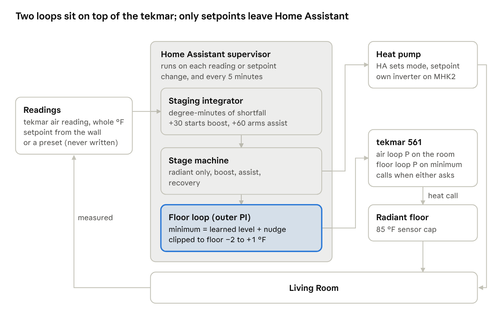
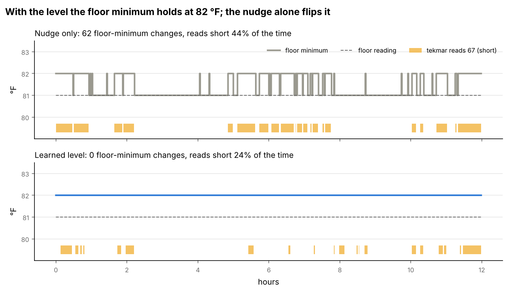
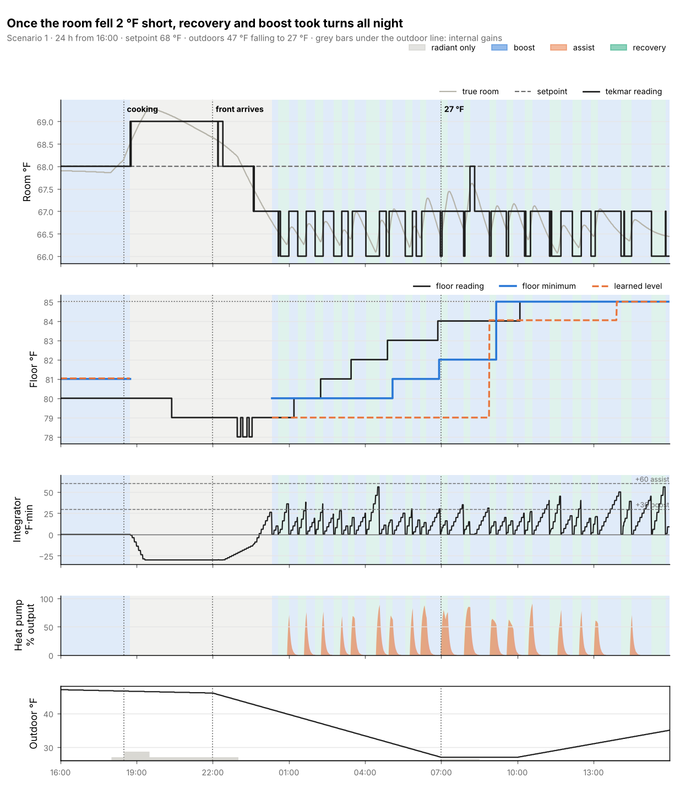
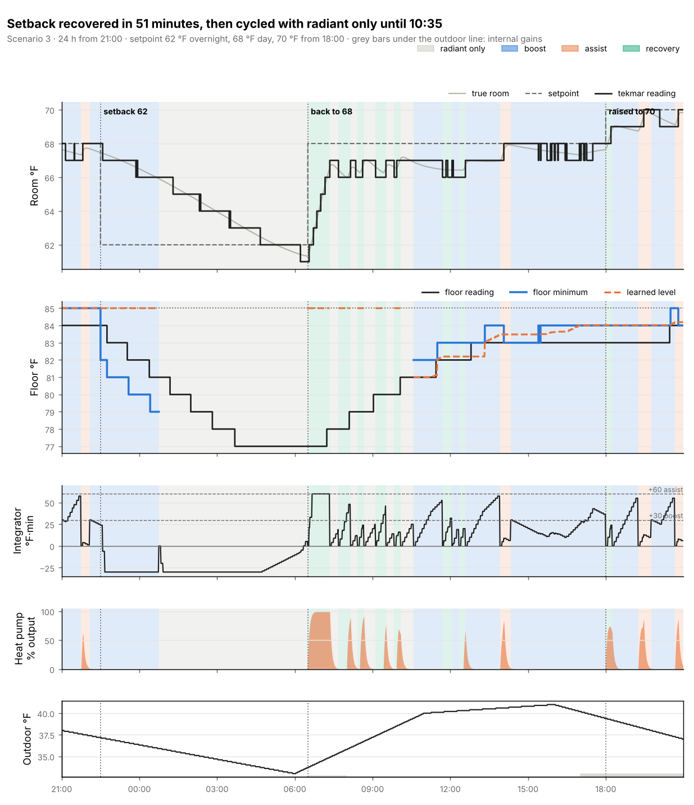
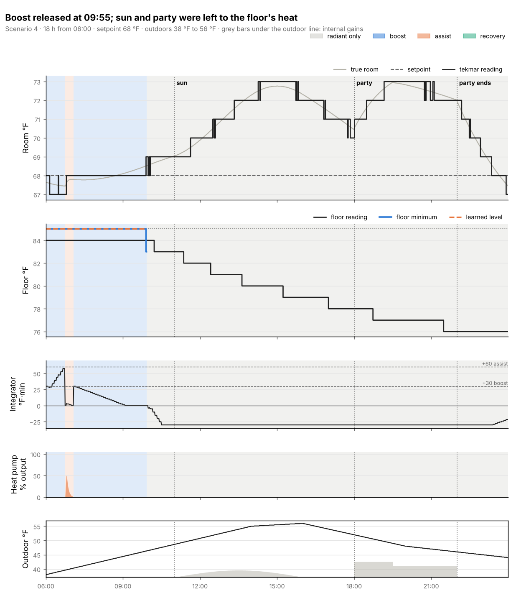
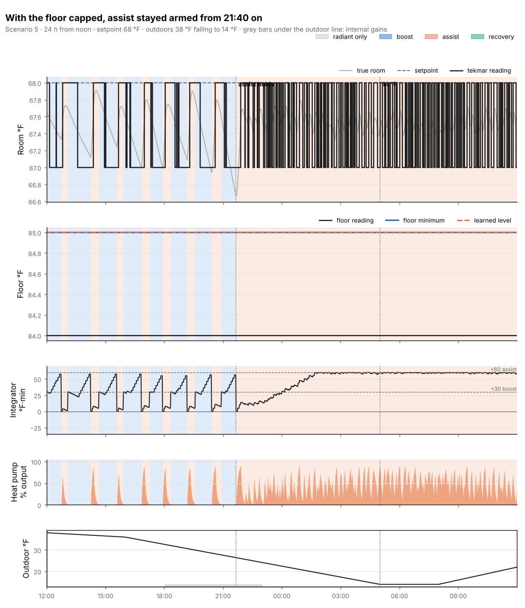

# Heat stage controller: control logic explained with scenarios

Companion to [heat_stage_controller_design.md](heat_stage_controller_design.md), covering revision 4.1 of the controller. Written 2026-11-27.

Every number and chart here comes from a simulation: the package's logic ported line by line to Python and run against a two-node room and floor model of the Living Room tuned to the observations in the design doc. The simulator and the script that regenerates every chart live in [`tools/heat_stage_sim/`](../tools/heat_stage_sim/). Read the results as behavior, not as forecasts.

## Summary

The learned floor level is what lets the room sit at setpoint instead of drooping below it: the 1 °F nudge says which way to move the floor, the level remembers where the floor has to be.

The controller is a supervisor with two pieces of memory on top of the tekmar. The outer PI loop writes the floor minimum: the learned level is its integral (I) term, the ±1 °F nudge its proportional (P) term. The staging integrator, in degree-minutes, decides when the heat pump is armed.

Why the level matters: when the room reads at setpoint, the nudge has nothing to act on, so a rule built on the floor reading leaves the floor minimum at the floor reading. There the tekmar's floor loop runs about 55%, the floor sags, and the room drifts short again. The level instead keeps the floor minimum a degree above the floor it actually produces, so the tekmar keeps running about 72% and the room stays put.

Simulated at a steady 45 °F outdoors, the room read setpoint 79% of the time with the level, 55% with the nudge alone, and 17% with the tekmar alone. The gain in true temperature is smaller, about 0.2 °F, because every decision runs on whole-degree readings: the controller holds the room just above 67.5 °F, where the tekmar's reading turns to 68.

The scenarios also turned up three behaviors worth knowing about (details in [What the simulations suggest](#what-the-simulations-suggest)):

1. When the load outruns the floor (a cold front, the morning after a setback), the controller cycles between boost or radiant only and recovery every 20 to 40 minutes, and rarely reaches assist.
2. On a fireplace evening, boost released three hours after the last short reading while the room was still warm, so the level it had held was discarded.
3. In assist the room is held at the bottom of the setpoint band, because the heat pump stops as soon as the tekmar reads setpoint.

## The control structure

The tekmar keeps its own two proportional loops; Home Assistant only moves the floor minimum (the setpoint of the tekmar's floor loop) and the heat pump's mode and setpoint. The highlighted floor loop is the part this document is mostly about. Living Room and Den run the same logic.

## The four stages

Rules are checked in order on every run and the first match wins; a 2 °F gap goes to recovery from either radiant only or boost, provided the heat pump has been off 15 minutes or is already resting. "Short" means the tekmar reads 1 °F or more below setpoint. The colors are the same in every scenario chart below: grey radiant only, blue boost, orange assist, green recovery.

## How the floor minimum is set

The floor minimum is a floor setpoint for the tekmar's own proportional floor loop, and the controller decides where to put it in two steps.

**Step 1, the PI output.** Every run:

    floor minimum = learned level + nudge
    nudge = +1 (room reads short), 0 (at setpoint), -1 (reads over)

**Step 2, the window.** The result is clipped to a window around the floor reading and rounded to a whole degree. The level itself is never clipped.

| Room reads | Floor minimum allowed |
| --- | --- |
| Short or at setpoint | floor reading − 2 to floor reading + 1, and under the 85 °F cap |
| 1 °F over | floor reading − 2 to floor reading − 1 |
| 2 °F or more over | floor reading − 2 (stop holding the floor) |

*From the observations in the design doc, section 7. The −1 °F point is a single 15-minute sample; points are joined for reading only.*

The window moves with the floor, so it limits how hard the floor is pushed at any moment, not where the floor can end up. A minimum held at floor + 1 keeps asking for a degree more as the floor climbs.

**Where the outer loop actually changes anything.** The tekmar's air loop runs 100% at 1.5 °F below setpoint, 50% at setpoint and 0% at 1.5 °F above, on a finer reading than it reports. The tekmar calls when either loop asks, so the floor minimum only matters when it asks for more than the air loop:

- **Room reads 1 °F short:** the air loop already asks for 67-100%, more than the 72% the window allows. The +1 nudge adds little.
- **Room reads at setpoint:** the air loop asks for 33-67%. This is where the floor minimum decides the outcome, and its position comes from the level.
- **Room reads over:** the air loop asks for less than 33%, and the minimum sits at least a degree under the floor, where the tekmar barely calls.

So the level's real job is to choose the duty while the room reads at setpoint:

| Level vs floor reading | Floor minimum at setpoint | tekmar on-time from the floor loop |
| --- | --- | --- |
| 1 °F or more above | floor + 1 (top of window) | about 72% |
| Within 1 °F | the level, about the floor | about 55% |
| 2 °F or more below (stale) | floor − 2 (bottom of window) | none; the air loop alone |

**How the level moves.** It moves 1 °F per 90 degree-minutes (`integral_minutes_per_degree`), which is 1 °F per 90 minutes with the room 1 °F off. It learns only in boost, only after the first 45 minutes, and only when the room is exactly 1 °F off:

| Room | Floor vs level | Level |
| --- | --- | --- |
| 1 °F short | floor above level − 1 | Rises; jumps to the floor reading first if the floor is above it |
| 1 °F short | floor 1 °F or more under the level | Holds: the floor is still catching up |
| 1 °F over | anywhere | Falls at the same rate, no jump down |
| At setpoint, or 2 °F or more off | anywhere | Holds |

It is frozen in assist and recovery, kept through radiant only, and reset to the floor reading on each entry to boost from radiant only.

## What the integral adds: a steady 45 °F day

With the learned level the floor minimum sits still at 82 °F all day; with the 1 °F nudge alone it changes 62 times in 12 hours, following the reading, and the room spends almost half the time reading short.

Three controllers were run against the same room: the tekmar alone (controller disabled), a nudge-only version where the floor minimum is built on the floor reading with no stored level, and revision 4.1 as written.

**Why the nudge alone falls short.** In the model, holding 68 °F at 45 °F needs the floor near 81.8 °F. The nudge pushes the minimum to floor + 1 while the room reads short, and the room recovers. As soon as it reads 68, the nudge goes to zero and the minimum drops back onto the floor reading, where the tekmar only runs about 55%. The floor slips, the room sags back to 67, and the cycle repeats. The floor reading is its only memory, and "hold the floor where it is" lets it slip because the tekmar's floor loop droops too.

**What the level does instead.** The level climbed to 82.0 °F and stopped, a degree above the 81 °F the floor actually settles at. That degree is the inner loop's own droop, learned. At setpoint the minimum stays at 82, the tekmar keeps the floor at 81 and a bit, and the room holds. The tekmar gets one unchanging command and does its own modulation, so its proportional control is not defeated.

The tekmar alone gets the floor high enough only by letting the room droop: its air loop needs about 73% on, which it asks for about 0.7 °F below setpoint. It read 67 for 83% of the day.

*24 simulated hours at each outdoor temperature, after a 36-hour warm-up.*

Across outdoor temperatures the picture has three bands:

- **50 °F:** the tekmar holds setpoint on its own and the controller never leaves radiant only.
- **45 to 40 °F:** the band where the level earns its keep, the radiant could hold setpoint but the tekmar's proportional control will not.
- **35 °F and colder:** the floor reaches its 85 °F cap, the level and the nudge behave the same, and the heat pump carries the rest.

The gain in true temperature is small: at 45 °F the mean room moves from 67.44 to 67.62 °F, at 40 °F from 67.12 to 67.53 °F. Nothing in a whole-degree reading separates 67.6 from 68.4, so the controller can only hold the room just above the point where the reading turns to 68. Getting closer to a true 68 would need a sub-degree room sensor in the decision.

## Scenario 1: a cold front overnight

When the outdoor temperature fell 20 °F overnight, the controller went radiant only → boost and then cycled between boost and recovery 19 times in 16 hours; it never reached assist.

Conditions: 16:00 to 16:00, setpoint 68 °F. Outdoors 47 °F until 22:00, falling to 27 °F by 07:00, back to 35 °F by 16:00. Two people home 18:00 to 23:00, cooking 18:30 to 19:30.

1. **16:00, boost.** Carried over from the previous day with a learned level of 81 °F and the floor at 80. The minimum sits at 81.
2. **18:45, boost → radiant only.** Cooking takes the room to 69. With the room over, the minimum drops under the floor reading, and it has been more than 3 hours since the last short reading, so boost releases. The floor minimum goes to 0. Over the evening the staging integrator runs down to its −30 floor.
3. **00:20, radiant only → boost.** The gains are gone and the outdoor temperature is falling. The room reads 67, the integrator climbs from −30 to +30, and boost starts. The level restarts at the floor reading, 79 °F; the 81 it held earlier is discarded.
4. **00:35 onward, boost ⇄ recovery.** The room reads 66, two degrees short, and recovery starts the heat pump. Recovery stops at 1 °F short after its 15 minutes, the heat pump goes off, and the stage returns to boost with the staging integrator at 0. The floor is still well behind the load, so the room loses its degree again in 15 to 30 minutes, before the integrator can reach the +60 that would arm assist. Recovery fires again.
5. **All night and morning.** The floor climbs from 79 to the 85 °F cap by 09:00, driven by the tekmar's own air loop (the room is 1.5 °F short, so it asks for 100%). The learned level stays at 79 until 08:54, because no boost period lasts the 45 minutes it needs before it may learn. The floor minimum, pinned at the bottom of the window, contributes nothing.

Over the 24 hours the room read setpoint 32% of the time and 2 °F short 21% of the time, and the heat pump changed from off to heat 19 times. Scenario 5 shows similar cold handled through assist, for contrast, and [What the simulations suggest](#what-the-simulations-suggest) tests two small changes that remove the cycling.

## Scenario 2: a fireplace evening

The learned level held through the fireplace as designed, but boost released three hours after the last short reading while the room was still 3 °F over, so the level was thrown away before the room cooled back down.

Conditions: 14:00 to 04:00, setpoint 68 °F, outdoors 44 °F easing to 39 °F. Two people home 18:00 to 23:00. Fireplace on 19:00 to 20:45, adding several times what two people do.

1. **14:00 to 19:00, boost with short assists.** The level is 82 °F, the floor 81, the minimum 82. The radiant is just short of the load, so three times (14:35, 16:40, 18:25) the integrator reaches +60 while the room reads 67 and assist arms the heat pump. Each time it runs about 10 minutes, the room reads 68, and 20 minutes later the stage drops back to boost with the integrator carried at +30.
2. **19:00 to 20:45, fireplace.** The room passes through 69 (1 °F over: the minimum is capped at floor − 1, and the level trims a little, 82.05 to 81.91) and reaches 71 (2 °F or more over: the minimum goes to floor − 2 and stops holding). The level then holds. The floor cools from 81 to 79. The integrator bottoms at −30.
3. **21:25, boost → radiant only.** Three hours after the 18:25 short reading, with the minimum under the floor, boost releases. The room is still 71. The floor minimum goes to 0.
4. **00:25, radiant only → boost.** The room is back to reading 67 and boost restarts with the level reset to the floor reading, 79 °F, instead of the 81.9 it had held. Seven minutes later it reads 66 and the boost ⇄ recovery cycling of scenario 1 begins.

Revision 4 reasoned that a fireplace evening would not last long enough to exit boost. The release clock counts from the last short reading, not from the start of the excursion, so any excursion that keeps the room at or over setpoint for 3 hours ends boost, and the room is rarely short just before the fireplace is lit. In a shorter run (a 45-minute fireplace at 36 °F) boost did hold, and the minimum went straight back to the top of the window once the room returned to setpoint.

## Scenario 3: overnight setback and an evening setpoint raise

Recovery closed a 7 °F setback gap in 51 minutes, but the room then cycled between radiant only and recovery for three hours; a 2 °F raise in the evening, starting from boost, was handled cleanly with the level kept.

Conditions: 21:00 to 21:00. Setpoint 68 °F, 62 °F from 22:30 to 06:30, raised to 70 °F at 18:00. Outdoors 38 °F, 33 °F at dawn, 41 °F in the afternoon. One person up 06:30 to 08:00, two home from 17:00.

1. **22:30, setpoint 68 → 62.** The room is 6 °F over, so the minimum goes to floor − 2 and the floor coasts down. Boost releases at 00:45, three hours after the last short reading. Stored heat in the floor keeps the room above 62 until about 05:00.
2. **06:30, setpoint 62 → 68, radiant only → recovery.** The room reads 61, 7 °F short. The heat pump runs at full output and the room reads 67 at 07:21. After 15 minutes and within 1 °F, recovery ends. The floor minimum is 0, so it returns to radiant only.
3. **07:21 to 10:35, radiant only ⇄ recovery.** The floor is at 78 against roughly 83 needed. Radiant only needs +30 on the integrator to start boost, about 30 minutes of 1 °F shortfall, but the room loses its degree within 15 to 30 minutes. Four more recovery runs follow before boost finally starts at 10:35 with the level at the floor reading, 81 °F.
4. **10:35 to 18:00, boost learns.** After two more recovery runs the level learns upward from 81 to 84 °F, with one assist at 13:55. From 14:20 boost holds the room at 68 on its own.
5. **18:00, setpoint 68 → 70, boost → recovery → boost.** The 2 °F step enters recovery. Recovery leaves the floor minimum and the level alone, so after 15 minutes it returns to boost with the level still at 84. The room reads 70 at 19:30, with two assists along the way because 70 °F at 38 °F needs more floor than the 85 °F cap allows.

The morning shows the same pattern as the cold front from another direction: recovery hands back to a stage whose integrator starts at 0, so a room that loses a degree quickly goes straight back to recovery. The evening shows the path that works: recovery returning to boost with a level already in place.

## Scenario 4: a mild sunny day and a dinner party

As the day warmed, boost released to radiant only at 09:55; from then on the controller wrote nothing while sun and a party pushed the room to 73 °F, because a floor that is already warm cannot be cooled.

Conditions: 06:00 to midnight, setpoint 68 °F. Outdoors 38 °F at dawn, 55 °F by 14:00, 44 °F at midnight. Sun through the windows 11:00 to 16:00. Dinner party 18:00 to 22:00 with eight people and cooking.

1. **06:00 to 09:55, boost.** After a cold night the level is 85 °F and the floor 84. One short assist at 06:45 as the room dips to 67.
2. **09:55, boost → radiant only.** The outdoor temperature climbs, the room reads 68 and then 69, the minimum falls under the floor reading, and three hours have passed since the 06:55 short reading. The floor minimum goes to 0 and the tekmar runs on its air loop alone.
3. **11:00 to 17:00, sun.** The room rises to 72.8 °F with the tekmar at 0%. The floor coasts from 84 to 78 °F, releasing stored heat for hours. The staging integrator sits at its −30 floor, which is about 30 minutes of extra patience the next time the room reads short.
4. **18:00 to 22:00, party.** Back to 73 °F. Nothing for the controller to do.
5. **Midnight.** The room is back to reading 67 with the integrator at −22, still radiant only. The 85 °F level from the morning is still stored but will be replaced by the floor reading (76 °F) when boost next starts.

The overshoot here is not the controller's doing: the floor minimum was released before the sun arrived. It is the floor's stored heat, which the original regression control would also have had, and only a lower floor ahead of a forecast warm afternoon would avoid it.

## Scenario 5: deep cold with the floor at its cap

With the floor pinned at its 85 °F cap, boost and assist alternated about once an hour until 21:40, and from then on assist simply stayed armed for 14 hours while the heat pump modulated: the path assist was designed for.

Conditions: noon to noon, setpoint 68 °F. Outdoors 38 °F at noon, falling to 14 °F by 05:00, 22 °F by noon. Two people home 18:00 to 23:00.

1. **12:00 to 21:40, boost ⇄ assist.** The floor is at 84 to 85 and the level at the cap, so the floor loop has nothing more to give and shortfall counts in full. Each cycle: boost starts with the integrator at the +30 carry, the room slips to 67, the integrator reaches +60 in 30 to 50 minutes, assist arms the heat pump, it runs 10 to 25 minutes, the room reads 68, and 20 minutes later assist hands back. Eight cycles.
2. **21:40 onward, assist holds.** The room now reads short again within the 20-minute hold every time, so assist never ends. The heat pump stays in heat mode with its setpoint one degree above or below its own reading, modulating between about 20% and 90% of output. The room's true temperature stays between 67.4 and 67.7 °F.
3. **Through the night.** The staging integrator sits at its +60 cap, unread in assist. The floor minimum stays at the cap. Nothing changes until the weather does.

Two things to note. The room is held at the bottom of the setpoint band, about 0.5 °F under 68, because assist turns the heat pump down as soon as the tekmar reads setpoint. And the freeze-protection rest was never exercised here: the 24-hour outdoor average only fell below 30 °F after 06:00, by which time assist already had the heat pump in heat mode.

## Which scenario shows what

Every transition in the stage table occurs at least once across the five scenarios; freeze-protection rest is the only behavior not exercised.

| Transition or behavior | Where to see it |
| --- | --- |
| radiant only → boost (integrator +30, level reset to floor reading) | Scenario 1 at 00:20, Scenario 3 at 10:35 |
| radiant only → recovery (2 °F gap) | Scenario 3 at 06:30, after the setback |
| boost → recovery (2 °F gap) | Scenario 3 at 18:00 (setpoint raise); Scenario 1 from 00:35, repeatedly |
| recovery → boost (floor minimum kept) | Scenario 3 at 18:15, level still 84 °F |
| recovery → radiant only (no floor minimum) | Scenario 3 at 07:21 |
| boost → assist (integrator +60, room short) | Scenario 2 at 14:35, Scenario 5 at 12:45 |
| assist → boost (20 minutes not short, carry +30) | Scenario 2 at 14:55, Scenario 5 eight times |
| assist held while the radiant is maxed out | Scenario 5 from 21:40 |
| boost → radiant only (3 h not short, minimum under floor) | Scenario 4 at 09:55, Scenario 2 at 21:25, Scenario 3 at 00:45 |
| Level learning upward | Scenario 3, 10:35 to 17:00 (81 to 84 °F) |
| Level trimming down at 1 °F over | Scenario 2 at 19:30 (82.05 to 81.91 °F) |
| Level held through a large excursion | Scenario 2, 19:30 to 21:25 |
| Floor minimum stops holding at 2 °F over | Scenario 2 during the fireplace, Scenario 3 after the setback |
| Staging integrator at its −30 floor | Scenarios 2 and 4 |
| Freeze-protection rest | Not exercised |

## What the simulations suggest

The biggest effect in these runs is not in the floor loop but in the hand-off out of recovery: it returns with the staging integrator at 0, so a room that is losing ground goes back to recovery before assist can arm. Nothing below has been changed in the package; these are what-if runs to weigh. Each variant can be switched on in the simulator (`variants=` in `simulate()`).

**1. Recovery hands back with nothing in the integrator.** Recovery stops 1 °F short, and the next stage starts at 0 degree-minutes (and, in boost, with the level paused for 45 minutes). Arming assist then takes 60 minutes of 1 °F shortfall; a room that drops back to 2 °F short in 15 to 30 minutes re-enters recovery first. Two one-line changes were tried:

- **A. Return from recovery to boost with the integrator at +60** (`assist_start_degree_minutes`), so a short reading after recovery arms assist on the next run. Simulator variant `recovery_returns_armed`.
- **B. In boost, send a 2 °F gap to assist instead of recovery**, so the heat pump runs to setpoint and stays armed rather than stopping 1 °F short. Simulator variant `boost_gap_goes_to_assist`.

| Scenario | Version | Reads setpoint | 2 °F short | Heat pump off → heat | Heat pump full-load hours |
| --- | --- | --- | --- | --- | --- |
| 1, cold front | revision 4.1 | 32% | 21% | 19 | 2.5 |
| 1, cold front | A | 68% | 4% | 6 | 4.4 |
| 1, cold front | B | 71% | 0% | 4 | 4.5 |
| 3, setback | revision 4.1 | 51% | 13% | 12 | 2.2 |
| 3, setback | A | 59% | 7% | 11 | 3.0 |
| 3, setback | B | 58% | 7% | 10 | 3.0 |
| 2, fireplace | revision 4.1 | 55% | 9% | 7 | 0.6 |
| 2, fireplace | A | 60% | 2% | 7 | 0.8 |
| 2, fireplace | B | 64% | 0% | 6 | 0.9 |

Both use more heat pump, because the room is actually held instead of sitting 1 to 2 °F short, and both cut the mode cycling. Neither touches the setback morning's radiant only ⇄ recovery loop, which goes through recovery → radiant only; carrying +30 into that hand-off, or going to boost when the floor is far behind, would be the equivalent there.

**2. The boost release clock runs during an excursion.** Pausing it while the room reads 2 °F or more over (variant `pause_release_while_far_over`) kept boost and the level through scenario 2. On its own it did not stop the sag after the fireplace, because the window still limits the push to floor + 1 while the floor recovers; combined with A, time 2 °F short fell from 9% to 2%.

**3. The level rarely learns when boost periods are short.** In scenario 1 it stayed at 79 °F for eight and a half hours while the floor climbed to 85, because no boost period lasted the 45-minute settling time. Harmless while the air loop is saturated, but the level is then wrong when the room comes back. Change A also fixes this indirectly, because boost periods get longer.

**4. The window caps the floor loop at about 72% with the room at setpoint.** Above that load the room must droop to raise the tekmar's duty, and that droop is also what arms assist. This is the trade chosen in revision 3: a `floor_max_lead` of 2 would allow 100% but turn the tekmar's floor control into on/off.

**5. The room sits in the bottom half of the setpoint band.** In boost and in assist the true room settles around 67.5 to 67.7 °F against 68. A whole-degree reading cannot do better; a sub-degree sensor in the decision, rather than only in a future derivative term, would.

**What the model cannot tell.** The tekmar's floor-loop duty below the floor reading (the measurement listed in the design doc, section 12), why the tekmar reading swings two to three times more than the room, and how the real heat pump modulates with the MHK2. Check those against live data before changing tunables on the strength of these runs.

## How the simulation works

The controller is the package's automation (steps 3 to 8) ported line by line to Python; the house is a two-node model of the Living Room tuned to the observations in the design doc, so the controller's behavior is exact and the room's is approximate.

**Controller.** Every stage rule, the level and integrator updates, the window, the heat pump setpoints and the offset learning are as written in [`packages/heat_stage_controller.yaml`](../packages/heat_stage_controller.yaml), with the default Living Room tunables. It runs on every change of the tekmar reading, on every setpoint change, and on the 5-minute tick, and integrates the error from before the change exactly as the automation does. Each run starts from a 36-hour warm-up.

**Room and floor.** In units where 1 is the room's heat loss per °F of room-to-outdoor difference:

    C_floor dT_floor/dt = Q_floor - H (T_floor - T_room)
    C_room  dT_room/dt  = H (T_floor - T_room) - (T_room - T_outdoor) + Q_heat_pump + Q_gains

| Part | Model | Matched to |
| --- | --- | --- |
| Floor needed to hold the room | room + 0.6 × (room − outdoor), same form as the k formula used for the old regression control | Radiant topping out at an 85 °F floor near 45 °F outdoors with a 70 °F setpoint |
| tekmar air loop | 100% at 1.5 °F below setpoint, 50% at setpoint, 0% at 1.5 °F above, on the unrounded room temperature | IOM-T-561 |
| tekmar floor loop | Duty from floor minimum minus floor: 0, 5, 55, 72, 100% at −2 to +2 °F | Design doc section 7 (one 1-minute call in 15 observed at −1 °F) |
| tekmar call | Either loop, on a 14-minute cycle; none at the 85 °F floor cap | Observed 12-14 minute cycling |
| Supply water | 100 + (70 − outdoor) °F, at most 140 °F; Navien boost adds 0.3 °F a minute after 15 minutes of continuous call | Supply near 120 °F early in a long call, climbing slowly |
| Floor response | About 0.8 °F an hour rising under full call, 1.2 °F an hour falling with none | First degree after 77-100 minutes of continuous call |
| Room | Time constant about 2.3 hours | Room reaching setpoint 5-8 minutes into a heat pump run |
| Heat pump | Full output 1.2 times the 30 °F design loss; inverter modulation with its own slow integral; starts 0.5 °F below its setpoint, stops 1 °F above | Overshoot on its own thermostat |
| Sensors | tekmar and MHK2 round to whole degrees with about 0.1 °F of wandering noise; MHK2 reads 1.5 °F below the tekmar | Heat pump reading below the tekmar on Nov 26 |
| Gains | Person 2, cooking 6, fireplace 20, sun up to 10 | A fireplace taking the room several degrees over |

**Checks.** With the controller off at 45 °F, the tekmar settles about 0.55 °F below setpoint at 73% duty and reads 67 most of the time, like the overnight shortfalls in the design doc. With the controller on, the level converges to 82 °F, a degree above the 81 °F floor that holds the room.

**Limits.** One room node, so no wall mass; the tekmar reading equals the room temperature, so the extra swing seen at the thermostat is not modeled; the sun is a simple bump; the Den is not simulated. The results show how the rules interact, not how many minutes a real recovery will take.

To regenerate the charts and tables: `python3 tools/heat_stage_sim/make_report.py` from the repo root (see the simulator's [README](../tools/heat_stage_sim/README.md)).
