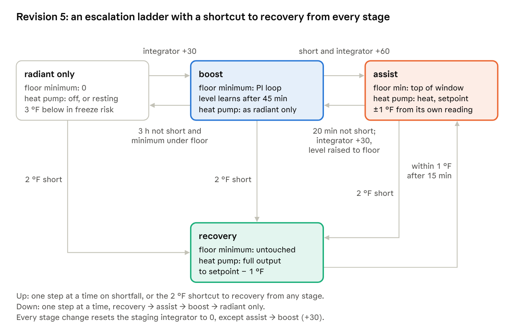
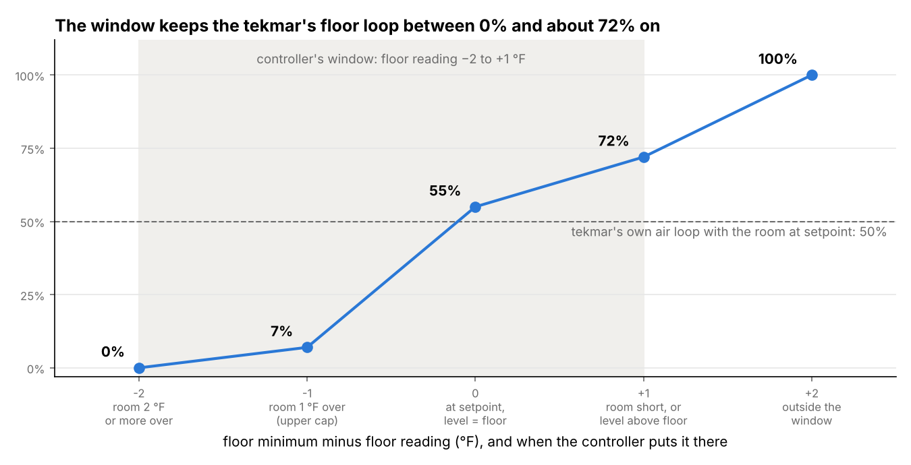
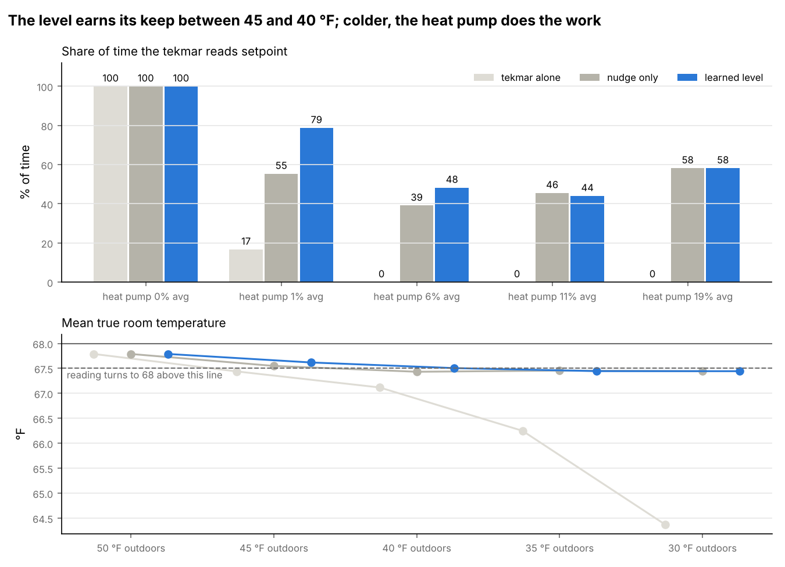
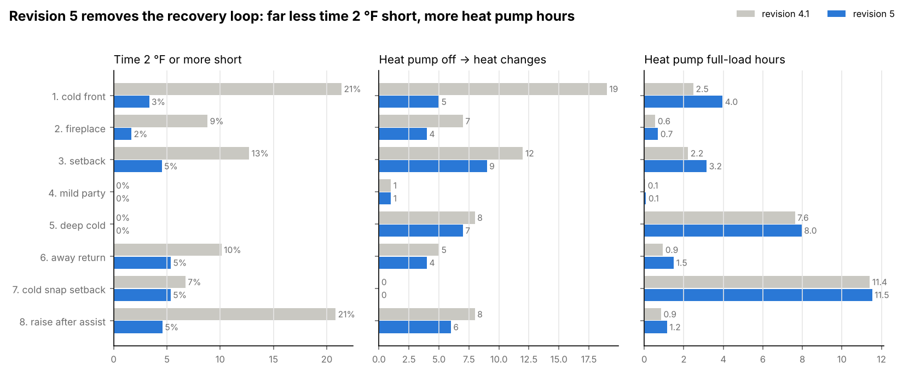
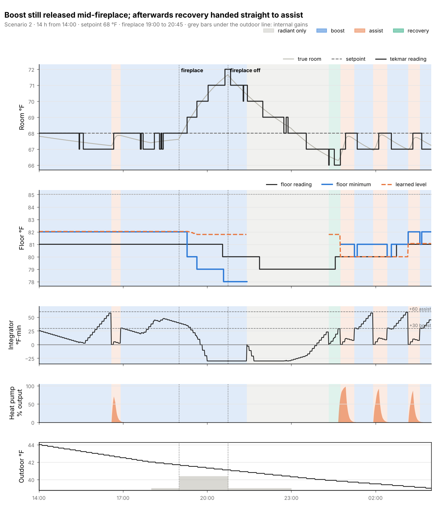
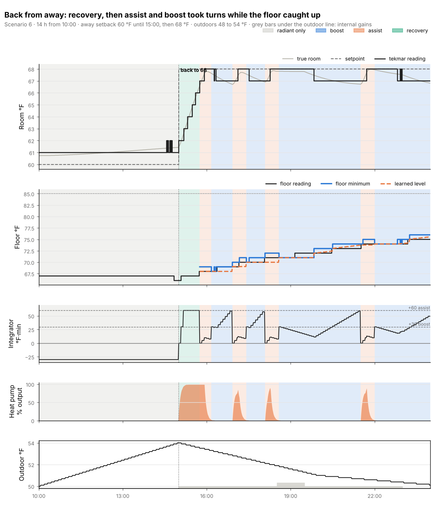
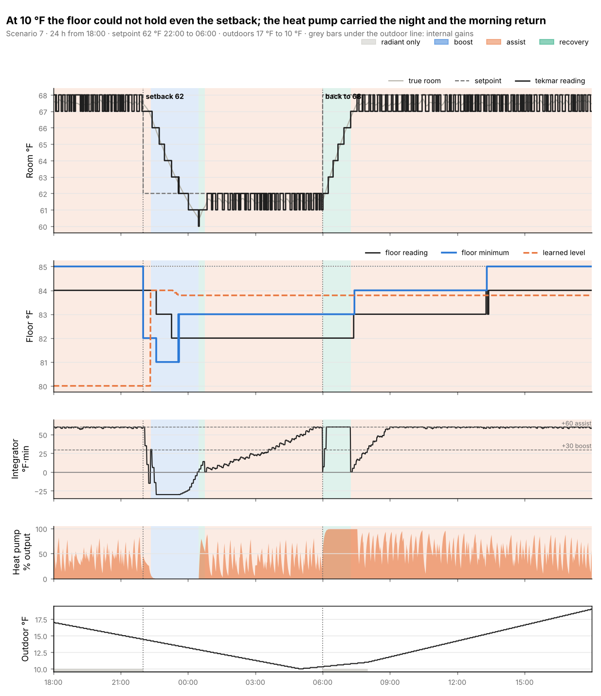
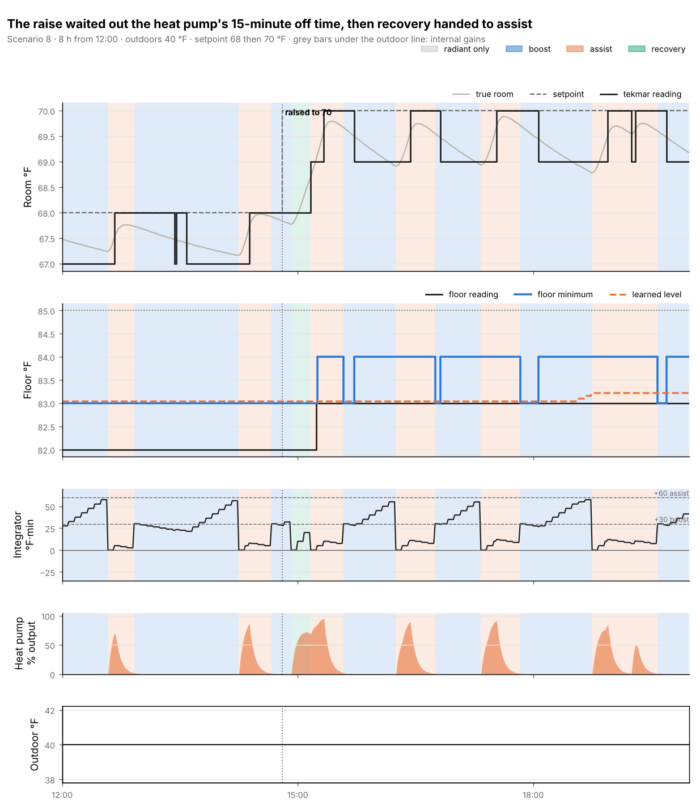

# Heat stage controller: control logic explained with scenarios

Companion to [heat_stage_controller_design.md](heat_stage_controller_design.md), covering revision 5 of the controller. Written 2026-11-27.

Every number and chart here comes from a simulation: the package's logic ported line by line to Python and run against a two-node room and floor model of the Living Room tuned to the observations in the design doc. The simulator and the script that regenerates every chart live in [`tools/heat_stage_sim/`](../tools/heat_stage_sim/). Read the results as behavior, not as forecasts.

## Summary

The stages form an escalation ladder. Shortfall moves the controller up one step at a time, radiant only → boost → assist, and a 2 °F gap from any stage takes a shortcut to recovery. Coming down is one step at a time: recovery → assist → boost → radiant only.

Within that ladder, the learned floor level is what lets the room sit at setpoint instead of drooping below it: the 1 °F nudge says which way to move the floor, the level remembers where the floor has to be. When the room reads at setpoint the nudge has nothing to act on, so a rule built on the floor reading leaves the floor minimum at the floor reading, where the tekmar's floor loop runs about 55% and the floor sags. The level keeps the minimum a degree above the floor it actually produces, so the tekmar keeps running about 72% and the room stays put. Simulated at a steady 45 °F outdoors, the room read setpoint 79% of the time with the level, 55% with the nudge alone and 17% with the tekmar alone.

Revision 5 changed how recovery ends. Up to revision 4.1 recovery handed back to boost or radiant only with the staging integrator at 0. When the floor was behind the load, the room lost its degree again before assist could arm and went straight back into recovery: 19 times in a simulated cold front. Recovery now always hands off to assist, which finishes the gap on the tekmar reading, pushes the floor to the top of its window and keeps the heat pump armed until the room holds. Time 2 °F short fell sharply in every scenario where the floor falls behind, at the cost of more heat pump hours.

Two things to know:

1. The room is held in the bottom half of the setpoint band, about 67.5 °F against 68, because every decision runs on whole-degree readings.
2. On a fireplace evening, boost still releases three hours after the last short reading while the room is warm, so the level it held is discarded. With the new hand-off the sag afterwards is caught by assist, so this no longer matters much.

## The control structure

The tekmar keeps its own two proportional loops; Home Assistant only moves the floor minimum (the setpoint of the tekmar's floor loop) and the heat pump's mode and setpoint. Living Room and Den run the same logic.

## The four stages

Rules are checked in order on every run and the first match wins. "Short" means the tekmar reads 1 °F or more below setpoint. The 2 °F shortcut to recovery applies from every other stage, provided the heat pump has been off 15 minutes or is already in heat mode (resting, or running in assist). The colors are the same in every scenario chart below: grey radiant only, blue boost, orange assist, green recovery.

## How the floor minimum is set

The floor minimum is a floor setpoint for the tekmar's own proportional floor loop.

**In boost**, the controller sets it in two steps. First the PI output:

    floor minimum = learned level + nudge
    nudge = +1 (room reads short), 0 (at setpoint), -1 (reads over)

Then the result is clipped to a window around the floor reading and rounded to a whole degree. The level itself is never clipped.

| Room reads | Floor minimum allowed |
| --- | --- |
| Short or at setpoint | floor reading − 2 to floor reading + 1, and under the 85 °F cap |
| 1 °F over | floor reading − 2 to floor reading − 1 |
| 2 °F or more over | floor reading − 2 (stop holding the floor) |

**In assist**, the radiant is behind by definition, so the floor minimum is held at the top of the window (floor reading + 1) unless the room reads over. The level stays frozen and is raised to the floor reading, if it is below it, when assist hands back to boost. **In recovery** the floor minimum is left as it is, and **in radiant only** it is always 0.

*From the observations in the design doc, section 7. The −1 °F point is a single 15-minute sample; points are joined for reading only.*

The window moves with the floor, so it limits how hard the floor is pushed at any moment, not where the floor can end up. A minimum held at floor + 1 keeps asking for a degree more as the floor climbs.

**Where the outer loop actually changes anything.** The tekmar's air loop runs 100% at 1.5 °F below setpoint, 50% at setpoint and 0% at 1.5 °F above, on a finer reading than it reports. The tekmar calls when either loop asks, so the floor minimum only matters when it asks for more than the air loop:

- **Room reads 1 °F short:** the air loop already asks for 67-100%, more than the 72% the window allows. The +1 nudge adds little.
- **Room reads at setpoint:** the air loop asks for 33-67%. This is where the floor minimum decides the outcome, and in boost its position comes from the level. In assist this is also when the top-of-window rule matters: the heat pump is satisfied, and the radiant keeps pushing.
- **Room reads over:** the air loop asks for less than 33%, and the minimum sits at least a degree under the floor, where the tekmar barely calls.

So in boost the level's real job is to choose the duty while the room reads at setpoint:

| Level vs floor reading | Floor minimum at setpoint | tekmar on-time from the floor loop |
| --- | --- | --- |
| 1 °F or more above | floor + 1 (top of window) | about 72% |
| Within 1 °F | the level, about the floor | about 55% |
| 2 °F or more below (stale) | floor − 2 (bottom of window) | none; the air loop alone |

**How the level moves.** It moves 1 °F per 90 degree-minutes (`integral_minutes_per_degree`), which is 1 °F per 90 minutes with the room 1 °F off. It learns only in boost, only after the first 45 minutes, and only when the room is exactly 1 °F off:

| Room | Floor vs level | Level |
| --- | --- | --- |
| 1 °F short | floor above level − 1 | Rises; jumps to the floor reading first if the floor is above it |
| 1 °F short | floor 1 °F or more under the level | Holds: the floor is still catching up |
| 1 °F over | anywhere | Falls at the same rate, no jump down |
| At setpoint, or 2 °F or more off | anywhere | Holds |

Besides learning, the level is set in three places: to the floor reading on entering boost from radiant only, to the floor reading when recovery started from radiant only hands off to assist, and up to at least the floor reading when assist hands back to boost.

## What the integral adds: a steady 45 °F day

With the learned level the floor minimum sits still at 82 °F all day; with the 1 °F nudge alone it changes 62 times in 12 hours, following the reading, and the room spends almost half the time reading short.

Three controllers were run against the same room: the tekmar alone (controller disabled), a nudge-only version where the floor minimum is built on the floor reading with no stored level, and the controller as written.

**Why the nudge alone falls short.** In the model, holding 68 °F at 45 °F needs the floor near 81.8 °F. The nudge pushes the minimum to floor + 1 while the room reads short, and the room recovers. As soon as it reads 68, the nudge goes to zero and the minimum drops back onto the floor reading, where the tekmar only runs about 55%. The floor slips, the room sags back to 67, and the cycle repeats. The floor reading is its only memory, and "hold the floor where it is" lets it slip because the tekmar's floor loop droops too.

**What the level does instead.** The level climbed to 82.0 °F and stopped, a degree above the 81 °F the floor actually settles at. That degree is the inner loop's own droop, learned. At setpoint the minimum stays at 82, the tekmar keeps the floor at 81 and a bit, and the room holds. The tekmar gets one unchanging command and does its own modulation, so its proportional control is not defeated.

The tekmar alone gets the floor high enough only by letting the room droop: its air loop needs about 73% on, which it asks for about 0.7 °F below setpoint. It read 67 for 83% of the day.

*24 simulated hours at each outdoor temperature, after a 36-hour warm-up.*

Across outdoor temperatures the picture has three bands:

- **50 °F:** the tekmar holds setpoint on its own and the controller never leaves radiant only.
- **45 to 40 °F:** the band where the level earns its keep, the radiant could hold setpoint but the tekmar's proportional control will not.
- **35 °F and colder:** the floor reaches its 85 °F cap, the level and the nudge behave the same, and the heat pump carries the rest.

The gain in true temperature is small: at 45 °F the mean room moves from 67.44 to 67.62 °F, at 40 °F from 67.12 to 67.51 °F. Nothing in a whole-degree reading separates 67.6 from 68.4, so the controller can only hold the room just above the point where the reading turns to 68. Getting closer to a true 68 would need a sub-degree room sensor in the decision.

## Revision 5 against revision 4.1

| Scenario | Revision | Reads setpoint | 2 °F short | Heat pump off → heat | Heat pump full-load hours | Stage changes |
| --- | --- | --- | --- | --- | --- | --- |
| 1. Cold front | 4.1 → 5 | 32% → 67% | 21% → 3% | 19 → 5 | 2.5 → 4.0 | 40 → 14 |
| 2. Fireplace evening | 4.1 → 5 | 55% → 65% | 9% → 2% | 7 → 4 | 0.6 → 0.7 | 16 → 10 |
| 3. Setback and raise | 4.1 → 5 | 51% → 59% | 13% → 5% | 12 → 9 | 2.2 → 3.2 | 26 → 21 |
| 4. Mild day and party | 4.1 → 5 | 96% → 96% | 0% → 0% | 1 → 1 | 0.1 → 0.1 | 4 → 3 |
| 5. Deep cold | 4.1 → 5 | 49% → 50% | 0% → 0% | 8 → 7 | 7.6 → 8.0 | 16 → 13 |
| 6. Away return, mild | 4.1 → 5 | 60% → 61% | 10% → 5% | 5 → 4 | 0.9 → 1.5 | 11 → 9 |
| 7. Setback in a cold snap | 4.1 → 5 | 45% → 52% | 7% → 5% | 0 → 0 | 11.4 → 11.5 | 8 → 5 |
| 8. Raise right after assist | 4.1 → 5 | 19% → 41% | 21% → 5% | 8 → 6 | 0.9 → 1.2 | 15 → 13 |

What changed, and why:

1. **Recovery always hands off to assist.** Recovery does two jobs: closing a gap made by raising the setpoint, and rescuing a room that drifted 2 °F short because the radiant could not keep up. Restarting the staging integrator at 0 afterwards is right for the first and wrong for the second, and in revision 4.1 a room that was losing ground went straight back into recovery. Handing off to assist works for both: the heat pump finishes the last degree on the tekmar reading and stays armed through assist's 20-minute hold. The alternatives considered are listed in the design doc, section 12.
2. **In assist the floor minimum sits at the top of its window.** With assist running for hours after a setback, a frozen level let the floor minimum sink to the bottom of the window whenever the heat pump had the room at setpoint, so the heat pump carried load the radiant could have taken. Pushing the floor during assist cut heat pump hours in the setback scenario from 3.6 to 3.2, at the cost of the room reading 67 a little more often while the floor catches up.
3. **The level is raised to the floor reading when assist hands back to boost**, so boost does not start with a level below the floor and leave the floor unsupported through its 45-minute settling time.
4. **The 2 °F shortcut to recovery applies from assist too.** A setpoint step made while assist is running gets recovery's full-output target instead of assist's 1 °F call. The heat pump is already in heat mode, so there is no minimum off time to wait out.
5. **The freeze rest moved to 3 °F below setpoint** (`rest_droop`), and **the freeze threshold to 20 °F** (`freeze_protect_outdoor_temp`, was 30 °F). Anything above 50 °F indoors protects the pipes, and in the model the radiant alone, on the tekmar's own control, holds about 50 °F down to roughly 10 °F outdoors, so 20 °F leaves margin. Neither change affected stage changes in the simulations: the recovery in scenario 7 comes from the radiant being unable to hold the setback, not from the resting heat pump.

The room is held instead of sitting 1 to 2 °F short, and that costs heat pump hours: 45 to 60% more in the cold front and the setback, where gas would have been the cheaper heat.

## Scenario 1: a cold front overnight

When the outdoor temperature fell 20 °F overnight, one recovery handed to assist, and boost and assist took turns until the heat pump settled into a long assist; the recovery loop of revision 4.1 is gone.

Conditions: 16:00 to 16:00, setpoint 68 °F. Outdoors 47 °F until 22:00, falling to 27 °F by 07:00, back to 35 °F by 16:00. Two people home 18:00 to 23:00, cooking 18:30 to 19:30.

1. **16:00, boost.** Carried over from the previous day with a learned level of 81 °F and the floor at 80.
2. **18:45, boost → radiant only.** Cooking takes the room to 69. With the room over, the minimum drops under the floor reading, and it has been more than 3 hours since the last short reading, so boost releases. Over the evening the staging integrator runs down to its −30 floor.
3. **00:20, radiant only → boost.** The room reads 67 and the integrator climbs from −30 to +30. The level restarts at the floor reading, 79 °F.
4. **00:35, boost → recovery → assist.** The room reads 66 and recovery starts the heat pump. At 01:00 it is within 1 °F and hands off to assist, which finishes the gap and pushes the floor to the top of its window.
5. **01:25 to 03:15, boost ⇄ assist.** Twice assist hands back after 20 minutes without a short reading; each time the level is raised to the floor reading, and with the integrator carried at +30 the room's next sag re-arms assist in about 40 minutes.
6. **03:15 to 11:20, assist holds.** The room reads short again within every 20-minute hold, so assist simply stays armed for eight hours. The floor climbs from 80 to 83 under the top-of-window minimum.
7. **11:55, one more shortcut.** Thirty-five minutes after assist hands back, the room drops 2 °F and recovery fires once more, handing to assist at 12:22. This is the ladder working as intended: a fast drop goes to the top, and the hand-off brings it straight back to assist.

Over the 24 hours the room read setpoint 67% of the time (32% in revision 4.1) and was 2 °F short 3% of the time (21%). The heat pump changed from off to heat 5 times (19) and ran 4.0 full-load hours (2.5).

## Scenario 2: a fireplace evening

Boost still released mid-fireplace and dropped its level, but when the room sagged afterwards, recovery handed straight to assist instead of cycling.

Conditions: 14:00 to 04:00, setpoint 68 °F, outdoors 44 °F easing to 39 °F. Two people home 18:00 to 23:00. Fireplace on 19:00 to 20:45, adding several times what two people do.

1. **14:00 to 19:00, boost.** The level is 82 °F, the floor 81, the minimum 82. One short assist at 16:35.
2. **19:00 to 20:45, fireplace.** The room passes through 69 (1 °F over: the minimum is capped at floor − 1, and the level trims a little) and reaches 71 to 72 (2 °F or more over: the minimum goes to floor − 2 and stops holding). The level holds at about 81.8. The floor cools from 81 to 79.
3. **21:25, boost → radiant only.** Three hours after the last short reading, with the minimum under the floor, boost releases while the room still reads 71.
4. **00:20, radiant only → recovery → assist.** The room has fallen to 66. Recovery runs for 25 minutes and hands to assist, which seeds the level from the floor reading (80 °F) because no floor minimum was in use. From 01:15 boost and assist take turns while the floor recovers.

Revision 4 reasoned that a fireplace evening would not last long enough to exit boost. The release clock counts from the last short reading, so any excursion that keeps the room at or over setpoint for 3 hours ends boost. Pausing the clock during the excursion was tried; with the new hand-off it no longer improved the outcome, because the sag after the fireplace is caught by assist either way.

## Scenario 3: overnight setback and an evening setpoint raise

After the setback, recovery handed to assist, which held the room while the floor climbed; the evening raise went recovery → assist → boost with the level kept.

Conditions: 21:00 to 21:00. Setpoint 68 °F, 62 °F from 22:30 to 06:30, raised to 70 °F at 18:00. Outdoors 38 °F, 33 °F at dawn, 41 °F in the afternoon. One person up 06:30 to 08:00, two home from 17:00.

1. **22:30, setpoint 68 → 62.** The room is 6 °F over, so the minimum goes to floor − 2 and the floor coasts down. Boost releases at 01:30. Stored heat in the floor keeps the room above 62 until about 05:00.
2. **06:30, setpoint 62 → 68, radiant only → recovery.** The room reads 61. The heat pump runs at full output and the room is within 1 °F at 07:22.
3. **07:22 to 09:25, assist.** Recovery hands to assist, which seeds the level at the floor reading (78 °F) and holds the floor minimum at floor + 1. The room first reads 68 at 07:31; the floor climbs to 79.
4. **09:25 to 18:00, boost ⇄ assist.** Each hand-back raises the level to the floor reading, and the floor climbs from 79 to 81 as boost and assist alternate. Revision 4.1 spent this morning cycling between radiant only and recovery.
5. **18:00, setpoint 68 → 70.** The 2 °F step enters recovery; 15 minutes later it hands to assist, and at 18:40 assist hands back to boost with the level at 82 °F. One more assist follows at 19:55, because 70 °F at 38 °F needs more floor than the 85 °F cap allows.

The cost: the heat pump ran 3.2 full-load hours against 2.2 in revision 4.1, and the room read setpoint 59% of the time against 51%.

## Scenario 4: a mild sunny day and a dinner party

As the day warmed, boost released to radiant only at 10:30; from then on the controller wrote nothing while sun and a party pushed the room to 73 °F, because a floor that is already warm cannot be cooled.

Conditions: 06:00 to midnight, setpoint 68 °F. Outdoors 38 °F at dawn, 55 °F by 14:00, 44 °F at midnight. Sun through the windows 11:00 to 16:00. Dinner party 18:00 to 22:00 with eight people and cooking.

1. **06:00 to 10:30, boost.** After a cold night the level is 84 °F and the floor 83. One short assist at 06:40.
2. **10:30, boost → radiant only.** The room reads 69, the minimum is under the floor reading, and three hours have passed since the last short reading.
3. **11:00 to 22:00, sun and party.** The room rises to about 73 °F with the tekmar at 0%. The floor coasts down, releasing stored heat for hours. The staging integrator sits at its −30 floor.
4. **Midnight.** The room is back to reading 67, still radiant only.

The overshoot is the floor's stored heat, not the controller: the floor minimum was released before the sun arrived. Only a lower floor ahead of a forecast warm afternoon would avoid it.

## Scenario 5: deep cold with the floor at its cap

With the floor at its 85 °F cap, boost and assist alternated until 20:50, and from then on assist stayed armed while the heat pump modulated.

Conditions: noon to noon, setpoint 68 °F. Outdoors 38 °F at noon, falling to 14 °F by 05:00, 22 °F by noon. Two people home 18:00 to 23:00.

1. **12:00 to 20:50, boost ⇄ assist.** The floor is at 83 to 85, so the floor loop has nothing more to give and shortfall counts in full. Each cycle: boost starts with the integrator at the +30 carry, the room slips to 67, the integrator reaches +60 in 30 to 50 minutes, assist runs for 25 to 60 minutes, including the 20-minute hold after the room last reads short, and hands back.
2. **20:50 onward, assist holds.** The room reads short again within every 20-minute hold, so assist never ends. The heat pump modulates between a few percent and about 95% of output; the room's true temperature stays between 67.3 and 67.8 °F.

The freeze-protection rest is not exercised here: the 24-hour outdoor average never falls below 20 °F.

## Scenario 6: back from away on a mild day

Back from a two-day away setback, recovery handed to assist, then boost and assist took turns for the rest of the day while the floor climbed about a degree an hour.

Conditions: 10:00 to midnight. Away setback at 60 °F for two days, setpoint back to 68 °F at 15:00. Outdoors 50 to 54 °F. Two people home from 15:00, cooking 18:30 to 19:30.

1. **15:00, radiant only → recovery.** The room reads 62 with the floor at 66. The heat pump runs at full output for 45 minutes.
2. **15:45, recovery → assist.** The level is seeded at the floor reading, 68 °F, and the floor minimum goes to the top of the window. The room reads 68 at 15:55.
3. **16:10 to midnight, boost ⇄ assist.** Three more assists of about 30 minutes each. The floor climbs from 68 to 75 °F, about a degree an hour: at mild outdoor temperatures the Navien's outdoor reset gives low supply water, so the floor recovers slowly. Each hand-back raises the level to the floor reading.

The floor needs about 79 °F to hold 68 on its own at these temperatures, so radiant only is not reached by midnight; at a degree an hour it would follow the next morning, three hours after the last short reading. This is the slow de-escalation the ladder implies: the heat pump covers the gap in short runs while the radiant catches up, and the floor minimum stays managed until the tekmar can manage alone.

## Scenario 7: a setback during a cold snap

At 10 to 17 °F outdoors the floor could not hold even the 62 °F setback: the room drifted 2 °F short once overnight, and the morning return to 68 °F, made while assist was running, went to recovery through the shortcut from assist.

Conditions: 18:00 to 18:00, after two days near 17 °F, so the 24-hour average is under the 20 °F freeze threshold and an idle heat pump rests in heat mode at setpoint − 3 °F. Setpoint 62 °F from 22:00 to 06:00, then 68 °F. Outdoors 17 °F falling to 10 °F by 05:00, 19 °F by 18:00.

1. **18:00 to 22:20, assist.** The floor is at its cap and the heat pump carries the rest.
2. **22:20, assist → boost.** The setback takes the room over its new setpoint and assist hands back. The heat pump drops to resting at 58 on its own sensor; the floor coasts from 84 to 82.
3. **00:28, boost → recovery → assist.** The room reaches 60, 2 °F short of the setback, and recovery hands to assist 17 minutes later. Assist holds the room at 61 to 62 for the rest of the night.
4. **06:00, setpoint 62 → 68, assist → recovery.** The 6 °F step takes the shortcut from assist. Recovery runs the heat pump toward setpoint − 1 at full output; the room reads 67 at 07:15, recovery hands back to assist, and the room reads 68 at 07:32. Assist stays armed for the rest of the day.

In the simulator the morning return took the same time with or without the shortcut from assist, because the modeled heat pump already reaches full output on assist's 1 °F call. A real inverter running on a 1 °F differential is expected to be gentler, which is what the shortcut is for.

## Scenario 8: a setpoint raise right after an assist run

A 2 °F raise eight minutes after assist handed back had to wait out the heat pump's 15-minute minimum off time, then recovery ran and handed to assist.

Conditions: noon to 20:00, outdoors 40 °F, setpoint 68 °F raised to 70 °F at 14:48.

1. **14:40, assist → boost.** The heat pump is switched off.
2. **14:48, setpoint 68 → 70.** The room is 2 °F short, but the heat pump may not start until it has been off 15 minutes. The integrator accumulates in boost.
3. **14:55, boost → recovery.** Recovery runs for 15 minutes and hands to assist at 15:10. The room reads 70 at 15:20.
4. **15:35 onward, boost ⇄ assist.** 70 °F at 40 °F needs more floor than the cap allows, so assist returns about every hour.

The minimum off time delays the response by up to 15 minutes. That is the price of protecting the heat pump from short cycling, and it applies equally to any stage that starts the heat pump.

## Which scenario shows what

| Transition or behavior | Where to see it |
| --- | --- |
| radiant only → boost (integrator +30, level reset to floor reading) | Scenario 1 at 00:20 |
| radiant only → recovery (2 °F gap) | Scenario 3 at 06:30, Scenario 6 at 15:00, Scenario 2 at 00:20 |
| boost → recovery (2 °F gap) | Scenario 3 at 18:00 (setpoint raise); Scenario 1 at 00:35 and 11:55 (drift); Scenario 8 at 14:55 (after the minimum off time) |
| recovery → assist, level seeded from the floor reading | Scenario 3 at 07:22, Scenario 6 at 15:45 |
| recovery → assist, level kept | Scenario 3 at 18:15, Scenario 1 at 01:00 |
| boost → assist (integrator +60, room short) | Scenario 5 at 12:40, Scenario 1 at 02:05 |
| assist → boost (carry +30, level raised to floor) | Scenario 6, four times; Scenario 3, six times |
| assist held while the radiant is maxed out | Scenario 5 from 20:50, Scenario 1 from 03:15 |
| boost → radiant only (3 h not short, minimum under floor) | Scenario 4 at 10:30, Scenario 2 at 21:25, Scenario 3 at 01:30 |
| Floor minimum at the top of the window during assist | Every assist period |
| Level learning upward in boost | Scenario 3 in the afternoon, Scenario 6 |
| Floor minimum stops holding at 2 °F over | Scenario 2 during the fireplace, Scenario 3 after the setback |
| Heat pump resting in freeze-risk weather (24 h average under 20 °F) | Scenario 7, 22:20 to 00:28 |
| assist → recovery (2 °F gap) | Scenario 7 at 06:00 |

## What to watch

- **Long assists.** Assist now runs for hours after a setback and through cold nights, with the floor minimum at floor + 1. Whether that overshoots once the heat pump stops has not been seen live.
- **Heat pump hours.** The room is held instead of sitting short, so the heat pump runs more: 45 to 60% more in the cold front and the setback. `assist_start_degree_minutes` still sets how readily boost escalates; `assist_hold_minutes` sets how long assist stays armed.
- **The shortcut from assist.** The simulator cannot show what it gains, because its heat pump already runs at full output on assist's 1 °F call. Watch how fast a setpoint step made during assist closes, compared with one made from boost.
- **Heat pump cycling inside assist.** In assist the heat pump setpoint flips between its own reading + 1 and − 1 each time the tekmar reading moves between short and setpoint. In the long assists of scenarios 5 and 7 the modeled compressor stops and starts every 15 to 20 minutes without leaving heat mode. This was already true in revision 4.1, but revision 5 spends far longer in assist. If it shows up live, a wider satisfied offset (reading − 2) or a minimum call time would calm it.
- **The room sits in the bottom half of the setpoint band** in boost and assist, around 67.5 to 67.7 °F against 68. A whole-degree reading cannot do better.
- **What the model cannot tell.** The tekmar's floor-loop duty below the floor reading (the measurement listed in the design doc, section 12), why the tekmar reading swings two to three times more than the room, and how the real heat pump modulates with the MHK2.

## How the simulation works

The controller is the package's automation (steps 3 to 8) ported line by line to Python; the house is a two-node model of the Living Room tuned to the observations in the design doc, so the controller's behavior is exact and the room's is approximate.

**Controller.** Every stage rule, the level and integrator updates, the window, the heat pump setpoints and the offset learning are as written in [`packages/heat_stage_controller.yaml`](../packages/heat_stage_controller.yaml), with the default Living Room tunables. It runs on every change of the tekmar reading, on every setpoint change, and on the 5-minute tick, and integrates the error from before the change exactly as the automation does. Each run starts from a 36-hour warm-up. Revision 4.1 can still be run for comparison (`revision="4.1"`).

**Room and floor.** In units where 1 is the room's heat loss per °F of room-to-outdoor difference:

    C_floor dT_floor/dt = Q_floor - H (T_floor - T_room)
    C_room  dT_room/dt  = H (T_floor - T_room) - (T_room - T_outdoor) + Q_heat_pump + Q_gains

| Part | Model | Matched to |
| --- | --- | --- |
| Floor needed to hold the room | room + 0.6 × (room − outdoor), same form as the k formula used for the old regression control | Radiant topping out at an 85 °F floor near 45 °F outdoors with a 70 °F setpoint |
| tekmar air loop | 100% at 1.5 °F below setpoint, 50% at setpoint, 0% at 1.5 °F above, on the unrounded room temperature | IOM-T-561 |
| tekmar floor loop | Duty from floor minimum minus floor: 0, 5, 55, 72, 100% at −2 to +2 °F | Design doc section 7 (one 1-minute call in 15 observed at −1 °F) |
| tekmar call | Either loop, on a 14-minute cycle; none at the 85 °F floor cap | Observed 12-14 minute cycling |
| Supply water | 100 + (70 − outdoor) °F, at most 140 °F; Navien boost adds 0.3 °F a minute after 15 minutes of continuous call | Supply near 120 °F early in a long call, climbing slowly |
| Floor response | About 0.8 °F an hour rising under full call, 1.2 °F an hour falling with none | First degree after 77-100 minutes of continuous call |
| Room | Time constant about 2.3 hours | Room reaching setpoint 5-8 minutes into a heat pump run |
| Heat pump | Full output 1.2 times the 30 °F design loss; inverter modulation with its own slow integral; starts 0.5 °F below its setpoint, stops 1 °F above | Overshoot on its own thermostat |
| Sensors | tekmar and MHK2 round to whole degrees with about 0.1 °F of wandering noise; MHK2 reads 1.5 °F below the tekmar | Heat pump reading below the tekmar on Nov 26 |
| Gains | Person 2, cooking 6, fireplace 20, sun up to 10 | A fireplace taking the room several degrees over |

**Checks.** With the controller off at 45 °F, the tekmar settles about 0.55 °F below setpoint at 73% duty and reads 67 most of the time, like the overnight shortfalls in the design doc. With the controller on, the level converges to 82 °F, a degree above the 81 °F floor that holds the room.

**Limits.** One room node, so no wall mass; the tekmar reading equals the room temperature, so the extra swing seen at the thermostat is not modeled; the sun is a simple bump; the Den is not simulated. The results show how the rules interact, not how many minutes a real recovery will take.

To regenerate the charts and tables: `python3 tools/heat_stage_sim/make_report.py` from the repo root (see the simulator's [README](../tools/heat_stage_sim/README.md)).
